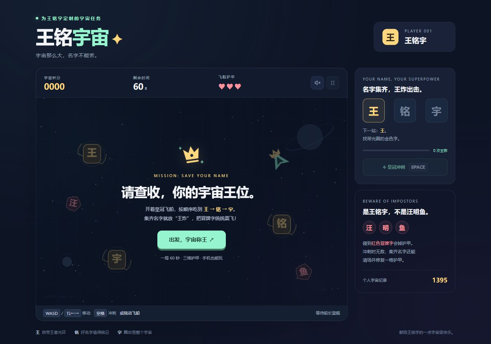

# 邱益美 · 名字里的小游戏

把一个名字，变成一段小小的冒险。四个名字，四份可以亲手打开的小礼物。

| 作品 | 玩法 | 打开 |
| --- | --- | --- |
| 王铭宇的王铭宇宙 | 驾驶皇冠飞船，收集名字，触发王炸；60 秒挑战 | [开始玩](games/wang.html) |
| 黄珊珊的珊瑚海 | 在海底收集名字，让珊瑚花园亮起来 | [开始玩](games/huang.html) |
| 赵少锴的少走弯路 | 走过三段迷宫，挑战更快的通关用时 | [开始玩](games/zhao.html) |
| 顾建泽的星河来信 | 回顾星光、建起鹊桥、润泽花海；来信、相册、音乐与吉他谱 | [打开演示版](games/gu.html) |

## 怎样打开

下载项目后，双击 `index.html`，用浏览器打开作品集首页。点击任意作品封面就可以开始玩。

每款游戏都是独立的 HTML 文件，支持离线使用，不用安装应用。手机上的聊天软件文件预览可能无法运行游戏，请下载后用支持 HTML 文件的浏览器打开。

前三款游戏的排行榜保存在当前浏览器里，不同设备之间不共享记录。切换浏览器或清理浏览器数据可能影响记录。

星河来信在这里提供公开演示版，以六幅星河插画展示相册与结尾来信的交互。私人照片和聊天没有收录在这个项目中。吉他谱是简化的伴奏参考谱。

## 作品里的心意

每个名字，都可以有自己的颜色、玩法和故事。我想把小小的心意，留在一份可以亲手打开的礼物里。

邱益美
